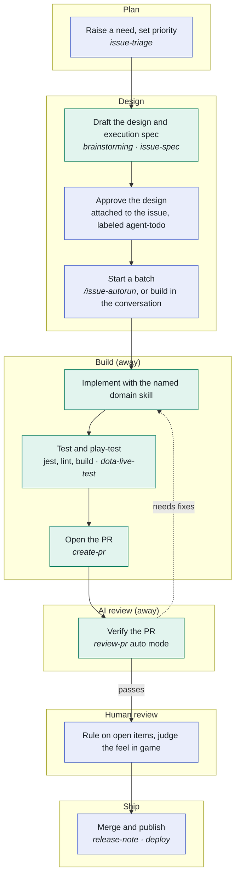

# AI Development Workflow

How an issue becomes a shipped update in Windy10v10AI. The goal is to let as much as possible run on its own: people decide what to build, approve the design, and judge the result. Everything in between is done by AI.

## The pipeline

Blue steps are done by people, green steps by AI. Steps marked _away_ run while nobody is watching.

| Stage | Who | What happens |
|---|---|---|
| Plan | Human | Raise a need and set its priority. `issue-triage` finds duplicates and stale issues and suggests a priority. Large work is split into native GitHub sub-issues. |
| Design | AI drafts, human approves | The design is discussed in a Claude artifact. Once approved it is attached to the issue, and the execution spec names the skill to use. |
| Build | AI subagent | Implements with the named skill, runs jest, lint and builds, play-tests in Dota 2 Tools, and opens a draft PR. |
| AI review | AI dispatcher | Verifies the PR against the spec and design: code, evidence and screenshots. Fixes are sent back to the subagent until it passes. |
| Human review | Human | Decides open items and plays the change in game. |
| Ship | Human | Merges, writes the release note and publishes to Steam Workshop. |

Small changes skip the batch: Claude builds them right in the conversation with the same skills.

## Domain skills

The execution spec names one of these. The AI reads it in full and follows its steps.

| Skill | Purpose |
|---|---|
| `custom-ability` | New ability written in TypeScript |
| `clone-ability` | Variant of a Dota ability |
| `awaken-ability` | Hero awakening ability |
| `custom-item` | New item or artifact |
| `clone-item` | Upgraded version of a Dota item |
| `add-image` | Icons and UI images |
| `bot-ability-usage` | When bots cast a spell |
| `bot-item-usage` | When bots use an item |
| `bot-ai-tuning` | Bot decisions and movement |
| `bot-skill-build` | Bot skill and talent order |

All skills live in [`.claude/skills/`](../.claude/skills/). [`AGENTS.md`](../AGENTS.md) lists them for tools other than Claude Code.

## Where things live

| What | Where |
|---|---|
| Design under discussion | A Claude artifact |
| Approved design | An HTML artifact named "Design" on the GitHub issue, plus a link back to the Claude artifact |
| Execution spec | The end of the issue body |
| Reports, shared rules for sub-issues | Markdown artifacts on the issue |
| Evidence | The PR. Its body holds what a person needs to decide; logs and check output go in one comment. It always shows the latest result. |
| Long-lived design | Module `README.md` files and code comments |

## Before you start

1. Set up the development environment as described in the [README](../README.md#get-started).
2. Install [Claude Code](https://claude.com/claude-code). The rules and skills in `.claude/` work out of the box.
3. Install the [GitHub CLI](https://cli.github.com/) and run `gh auth login`. Pull requests, issues and artifacts all go through it.
4. Batch runs additionally need a local agent harness for the subagents.
