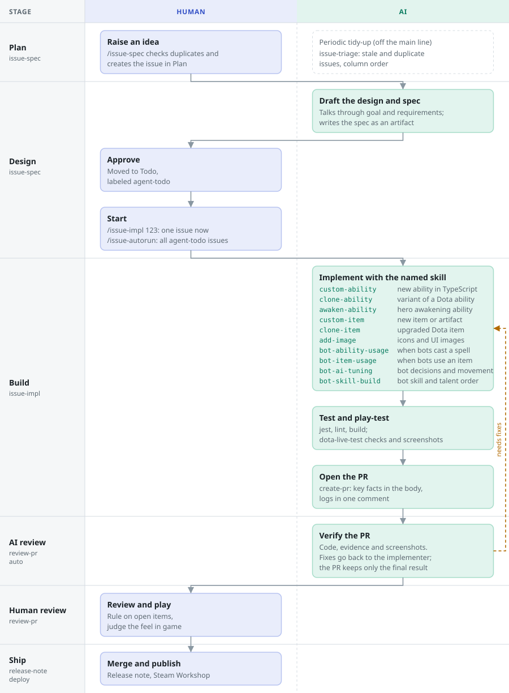

# AI Development Workflow

English | [简体中文](ai-workflow_ZH.md)

How an issue becomes a shipped update in Windy10v10AI. The goal is to let as much as possible run on its own: people decide what to build, approve the design, and judge the result. Everything in between is done by AI.

## The pipeline

Blue steps are done by people, green steps by AI. The dashed loop is the retry when a review fails.

| Stage | Who | What happens |
|---|---|---|
| Plan | Human | Raise a need and set its priority. `issue-triage` finds duplicates and stale issues and suggests a priority. Large work is split into native GitHub sub-issues. |
| Design | AI drafts, human approves | Use `/issue-spec` to settle the goal and requirements; complex designs are discussed in an artifact. Once approved it is attached to the issue, and the execution spec names the skill to use. |
| Build | AI | `issue-impl` implements with the named skill, runs jest, lint and builds, play-tests in Dota 2 Tools, and opens a PR. |
| AI review | AI | Verifies the PR against the spec and design: code, evidence and screenshots. Fixes are sent back to the implementer until it passes. |
| Human review | Human | Decides open items and plays the change in game. |
| Ship | Human | Merges, writes the release note and publishes to Steam Workshop. |

Small changes need no issue: Claude builds them right in the conversation with the same skills.

## Domain skills

The execution spec names one of these. The AI reads it in full and follows its steps.

| Skill | Purpose |
|---|---|
| `custom-ability` | New ability written in TypeScript |
| `clone-ability` | Variant of a Dota ability |
| `awaken-ability` | Hero awakening ability |
| `custom-item` | New item or artifact |
| `clone-item` | Upgraded version of a Dota item |
| `add-image` | Icons and UI images |
| `bot-ability-usage` | When bots cast a spell |
| `bot-item-usage` | When bots use an item |
| `bot-ai-tuning` | Bot decisions and movement |
| `bot-skill-build` | Bot skill and talent order |

All skills live in [`.claude/skills/`](../.claude/skills/). [`AGENTS.md`](../AGENTS.md) lists them for tools other than Claude Code.

## Where things live

| What | Where |
|---|---|
| Design under discussion | An artifact |
| Approved design | An HTML artifact named "Design" on the GitHub issue, plus a link back to the artifact |
| Background, goal, requirements, acceptance, release note | The issue body, for people |
| Execution spec | A Markdown artifact named "Execution spec" on the issue, for the AI |
| Reports, shared rules for sub-issues | Markdown artifacts on the issue |
| Evidence | The PR. Its body holds what a person needs to decide; logs and check output go in one comment. It always shows the latest result. |
| Long-lived design | Module `README.md` files and code comments |

## From an idea to an issue: polish it with /issue-spec

An idea alone often leaves the "how" vague. `/issue-spec` is an AI skill that turns a rough idea into an issue that is ready to build. A rough idea is fine; you don't need to know the approach first.

**How to use it**

1. Open this repository in Claude Code.
2. Type `/issue-spec` followed by a sentence about your idea, or the link to an issue. With nothing after it, it starts from the top issue in the project's Plan column.
3. Answer its questions. It asks one at a time: simple ones come with a few options, complex ones (flows, numbers, comparing approaches, UI) get a web page to discuss with you.

**What you get**

- The issue body: background, goal, **requirements**, acceptance and release note, all kept short.
- An execution spec written for the AI: approach, files to change, what not to do, check commands and in-game verification steps. You don't need to read it closely.
- "Requirements" holds only what you decided yourself. Anything the AI inferred or set by default goes in the execution spec, marked as a suggestion, so you can tell which is which.

**Titles**: write the outcome you want, not which thing to edit. For example "Weaken tower mana burn against heroes", not "Change the mana burn level table to ...".

**After the talk**: the issue's project Status moves to Todo, waiting for the AI or a maintainer to start. Contributors without write access get as far as a clear plan; a maintainer writes it into the issue and moves the card.

| Position in the project | Meaning |
|---|---|
| Backlog | Not planned yet |
| Plan | Decided to do, but goal and requirements are not worked out yet; waiting for `/issue-spec` |
| Todo | Worked out, waiting to start |
| In progress | Being worked on, including stuck halfway or a PR waiting for review |
| Done | Finished within the last week |

Higher in a column means done sooner.

## Before you start

1. Set up the development environment as described in the [README](../README.md#get-started).
2. Install [Claude Code](https://claude.com/claude-code). The rules and skills in `.claude/` work out of the box.
3. Install the [GitHub CLI](https://cli.github.com/) and run `gh auth login`. Pull requests, issues and artifacts all go through it.
