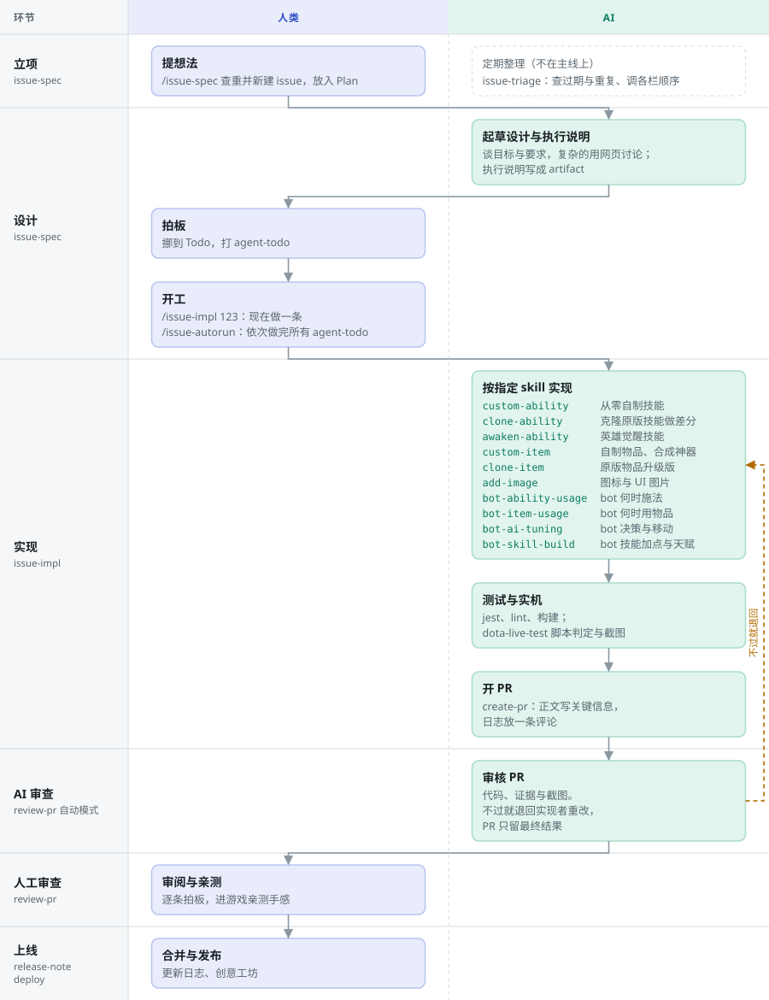

# AI 开发流程

[English](ai-workflow.md) | 简体中文

Windy10v10AI 的一个 issue 怎样变成上线的更新。目标是尽量自动：人只决定做什么、拍板设计、判定结果，中间全部交给 AI。

## 流水线

蓝色是人做的，绿色是 AI 做的。虚线回环是审查不过时的重做。

| 环节 | 谁做 | 做什么 |
|---|---|---|
| 立项 | 人 | 提想法。`/issue-spec` 先查重，再新建 issue 放进 Plan，并补优先级；大的工作拆成 GitHub 原生子 issue。`issue-triage` 不在主线上，想整理时才用（查重复与过期、调各栏顺序） |
| 设计 | AI 起草，人拍板 | 用 `/issue-spec` 谈目标与要求，复杂的在 artifact 里讨论，定稿后挂到 issue；执行说明写明用哪个 skill |
| 实现 | AI | `issue-impl` 按指定 skill 实现，跑 jest、lint 与构建，在 Dota 2 Tools 实机验证，开 PR |
| AI 审查 | AI | 对照执行说明与设计审核 PR：代码、证据与截图。不过就退回实现者重改，直到通过 |
| 人工审查 | 人 | 处理待定事项，进游戏亲测 |
| 上线 | 人 | 合并、写更新日志、发布到创意工坊 |

小改动不用开 issue：Claude 直接在对话里用同样的 skill 做完。

## 领域 skill

执行说明会指定其中一个，AI 完整读完并照它的步骤做。

| Skill | 用途 |
|---|---|
| `custom-ability` | 用 TypeScript 从零自制技能 |
| `clone-ability` | 克隆原版技能做差分 |
| `awaken-ability` | 英雄觉醒技能 |
| `custom-item` | 自制物品、合成神器 |
| `clone-item` | 原版物品的升级版 |
| `add-image` | 图标与 UI 图片 |
| `bot-ability-usage` | bot 何时施法 |
| `bot-item-usage` | bot 何时用物品 |
| `bot-ai-tuning` | bot 决策与移动 |
| `bot-skill-build` | bot 技能加点与天赋 |

全部 skill 在 [`.claude/skills/`](../.claude/skills/)，[`AGENTS.md`](../AGENTS.md) 为 Claude Code 以外的工具列出了对照表。

## 东西放在哪

| 内容 | 位置 |
|---|---|
| 讨论中的设计 | artifact |
| 定稿设计 | GitHub issue 上名为「设计」的 HTML artifact，外加一个指回 artifact 的链接 |
| 背景、目标、要求、验收、Release Note | issue 正文，给人看 |
| 执行说明 | issue 上名为「执行说明」的 Markdown artifact，给 AI 读 |
| 报告、子 issue 共用规约 | issue 上的 Markdown artifact |
| 证据 | PR。正文只写人做判断要看的内容，日志与判定输出放一条评论，始终是最新结果 |
| 长期设计 | 模块 `README.md` 与代码注释 |

## 从想法到 issue：用 /issue-spec 打磨

光有一个想法，如何实现往往比较模糊。`/issue-spec` 是一个 AI skill，帮你把粗略的想法谈成一条可以直接开工的 issue。想法很粗也没关系，不用先想好做法。

**怎么用**

1. 在 Claude Code 里打开本仓库。
2. 输入 `/issue-spec`，后面接一句想法，或者一条 issue 的链接。不接内容时，从项目 Plan 栏最上面那条开始。
3. 回答它的问题。它一次只问一个：简单的给你几个选项，复杂的（流程、数值、方案对比、界面）会做一页网页和你讨论。

**你会得到什么**

- issue 正文：背景、目标、**要求**、验收、Release Note，都写得很短。
- 一份给 AI 看的「执行说明」：做法、改动范围、不做什么、验收命令、实机验证步骤。你不用细看。
- 「要求」只写你亲口拍板的内容。AI 自己推断、按默认定的取舍写在执行说明里并标「建议」，方便你分辨哪些是你定的。

**一个例子**

> 你：`/issue-spec` 玩家反馈电脑后期不冲高地，想让它更敢打
> AI：电脑只在三塔之外守着，你希望它冲到哪里为止？ A. 到四塔附近，不靠近基地（推荐） B. 一直打到基地
> 你：A
> AI：（接着问强攻频率、要不要补测试……谈完后列出你拍板的、按默认做的、怎么验收）

**标题怎么写**：写你想要的结果，不写具体改哪个东西。例如「减弱防御塔对英雄的削蓝」，不要写「把削蓝技能的等级表改成……」。

**谈完之后**：这条 issue 的项目 Status 会挪到 Todo，等 AI 或维护者开工。没有写入权限的参与者负责谈清楚，写入 issue 和挪卡片由维护者来做。

| 项目里的位置 | 含义 |
|---|---|
| Backlog | 尚未计划 |
| Plan | 决定要做，但目标和要求还没谈清楚，等 `/issue-spec` |
| Todo | 已经谈清楚，等着开工 |
| In progress | 已经在做，包括做到一半卡住、PR 等审 |
| Done | 最近一周完成 |

同一栏里越靠上越先做。

## 开始之前

1. 按 [README](README_ZH.md) 装好开发环境。
2. 装 [Claude Code](https://claude.com/claude-code)，`.claude/` 里的规则与 skill 开箱即用。
3. 装 [GitHub CLI](https://cli.github.com/) 并运行 `gh auth login`：PR、issue 与附件都靠它。
