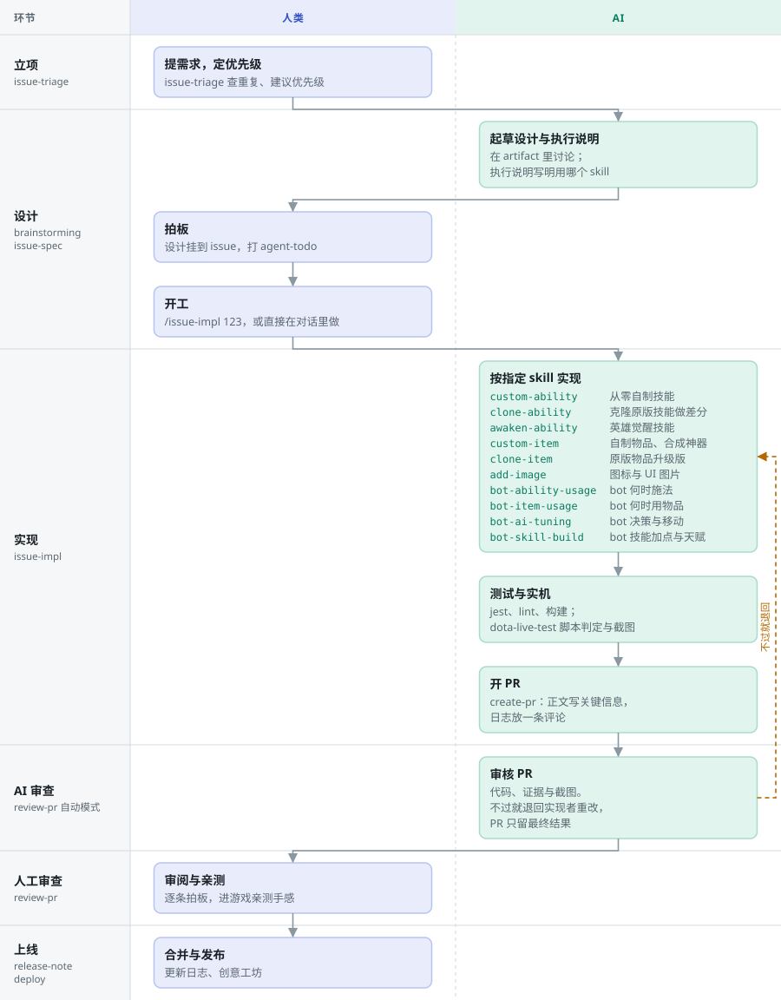

# AI 开发流程

[English](ai-workflow.md) | 简体中文

Windy10v10AI 的一个 issue 怎样变成上线的更新。目标是尽量自动：人只决定做什么、拍板设计、判定结果，中间全部交给 AI。

## 流水线

蓝色是人做的，绿色是 AI 做的。默认一次做一条 issue：`/issue-impl`。虚线回环表示审查不过时的重做，以及批量模式 `/issue-autorun`：你不在时，对每条 issue 重复同样的步骤。

| 环节 | 谁做 | 做什么 |
|---|---|---|
| 立项 | 人 | 提需求、定优先级。`issue-triage` 查重复与过期、建议优先级；大的工作拆成 GitHub 原生子 issue |
| 设计 | AI 起草，人拍板 | 设计在 artifact 里讨论，定稿后挂到 issue；执行说明写明用哪个 skill |
| 实现 | AI | `issue-impl` 按指定 skill 实现，跑 jest、lint 与构建，在 Dota 2 Tools 实机验证，开草稿 PR。批量模式下由子代理做，做完交回主对话 |
| AI 审查 | AI | 对照执行说明与设计审核 PR：代码、证据与截图。不过就退回实现者重改，直到通过 |
| 人工审查 | 人 | 处理待定事项，进游戏亲测 |
| 上线 | 人 | 合并、写更新日志、发布到创意工坊 |

批量模式只多了外面一层循环：给 issue 排顺序、把每条交给照 `issue-impl` 做的子代理、判定结果、最后统一汇报。小改动连 issue 都不用开：Claude 直接在对话里用同样的 skill 做完。

## 领域 skill

执行说明会指定其中一个，AI 完整读完并照它的步骤做。

| Skill | 用途 |
|---|---|
| `custom-ability` | 用 TypeScript 从零自制技能 |
| `clone-ability` | 克隆原版技能做差分 |
| `awaken-ability` | 英雄觉醒技能 |
| `custom-item` | 自制物品、合成神器 |
| `clone-item` | 原版物品的升级版 |
| `add-image` | 图标与 UI 图片 |
| `bot-ability-usage` | bot 何时施法 |
| `bot-item-usage` | bot 何时用物品 |
| `bot-ai-tuning` | bot 决策与移动 |
| `bot-skill-build` | bot 技能加点与天赋 |

全部 skill 在 [`.claude/skills/`](../.claude/skills/)，[`AGENTS.md`](../AGENTS.md) 为 Claude Code 以外的工具列出了对照表。

## 东西放在哪

| 内容 | 位置 |
|---|---|
| 讨论中的设计 | artifact |
| 定稿设计 | GitHub issue 上名为「设计」的 HTML artifact，外加一个指回 artifact 的链接 |
| 执行说明 | issue 正文末尾 |
| 报告、子 issue 共用规约 | issue 上的 Markdown artifact |
| 证据 | PR。正文只写人做判断要看的内容，日志与判定输出放一条评论，始终是最新结果 |
| 长期设计 | 模块 `README.md` 与代码注释 |

## 开始之前

1. 按 [README](README_ZH.md) 装好开发环境。
2. 装 [Claude Code](https://claude.com/claude-code)，`.claude/` 里的规则与 skill 开箱即用。
3. 装 [GitHub CLI](https://cli.github.com/) 并运行 `gh auth login`：PR、issue 与附件都靠它。
4. 批量模式把每条 issue 交给子代理做。用哪个模型、哪套运行环境是个人选择，写在你自己的全局 Claude Code 指令里。
